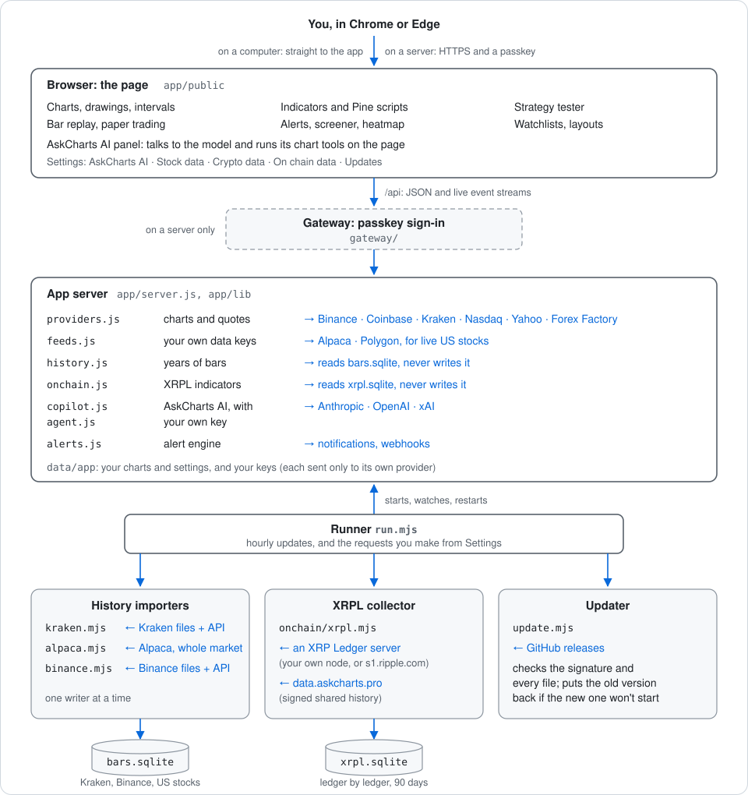

# Architecture

AskCharts is a web page and a few plain Node programs, and it all runs on your own computer or your own server.
There's no account to sign up for. This page shows how the pieces fit, so you know what runs where and where your
data is kept.

## The pieces

- **The page** (`app/public/`) is everything you see: charts, drawings, indicators and Pine scripts, the strategy
  tester, bar replay, paper trading, alerts and Settings. AskCharts AI's panel lives here too. When the AI asks to
  change the chart, it's the page that does it, the same way your own clicks would.
- **The gateway** (`gateway/`) only runs on a server. It's the passkey sign-in in front of the app, so nothing on
  the internet reaches the app without it. On your own computer the page talks to the app directly.
- **The app server** (`app/server.js` and `app/lib/`) answers the page. It fetches prices from the public sources,
  and from Alpaca or Polygon when you've added your own key. It reads the stored history, runs your alerts, and
  sends AskCharts AI's questions to the provider you picked (Anthropic, OpenAI or xAI) with your key.
- **The runner** (`run.mjs`) starts the app and keeps it running. It runs the history importers each hour, and
  when you ask for something in Settings. It keeps the XRPL collector going while it's on, and checks for updates
  once a day.
- **The history importers** (`history/`) download years of bars into one store, `bars.sqlite`: Kraken's
  archives, Binance's monthly files (each checked against Binance's own checksum) and US stocks from Alpaca.
  Only one runs at a time.
- **The XRPL collector** (`onchain/xrpl.mjs`) follows the XRP Ledger, ledger by ledger, from your own node or a
  public server like s1.ripple.com. When it starts it can fill in up to 90 days from data.askcharts.pro, where
  every file is signed. It keeps 90 days in `xrpl.sqlite`.
- **The updater** (`update.mjs`) checks GitHub for a newer release on a computer. Before anything stops, it checks
  the release's signature and every file. If the new version doesn't start, the old one comes back by itself.
  On a server with Docker, Settings, Updates shows the commands instead.

## Where your data lives

Everything you make is in the `data` folder beside the program, never mixed in with the code. That's why an
update can replace the program without touching your work.

| Folder | What's in it |
|---|---|
| `data/app` | Your charts, layouts, watchlists, alerts and settings, and your AI and data keys |
| `data/custom` | Your own indicators |
| `data/history` | The history store (`bars.sqlite`) and what the importers last did |
| `data/onchain` | The XRP Ledger store (`xrpl.sqlite`) and the collector's settings |
| `data/gateway` | Passkeys and sessions, on a server only |
| `data/updates` | What the Updates page shows |

Your keys sit in a file only your account can read. Each key is only ever sent to its own provider, and a saved
key is never sent back to the page.

## How a chart gets its bars

1. The page asks the app server for a symbol and an interval.
2. If the history store has that symbol, the app sends the stored bars, and only the newest ones come live from
   the exchange or feed.
3. If it doesn't, the app asks the public sources, your own keys first. If one doesn't answer, the next takes
   over, and the chart says which one it used.
4. While the chart is open it keeps up to date. Binance's live prices stream straight from Binance to the page;
   the rest come through the app every few seconds.

## How AskCharts AI works

1. You type a question in the panel. The page sends it to the app server, with what's on your chart if you've
   allowed that in Settings.
2. The app server adds AskCharts' own guide and sends it all to your provider, with your key.
3. If the model wants to look at or change the chart, it asks for a tool. The page runs it and sends the result
   back, and this repeats until the model has its answer.
4. Every change it makes shows as a step you can undo. Removing several things always asks you first.

## A few rules it keeps

- **Nothing big downloads by itself.** Each history store and the XRPL collector stay off until you turn them on.
- **One writer per store.** The importers and the collector write the stores; the app only reads them.
- **Your data stays yours.** It's on your computer or your server, and AskCharts doesn't send anything to me.
